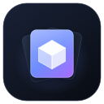
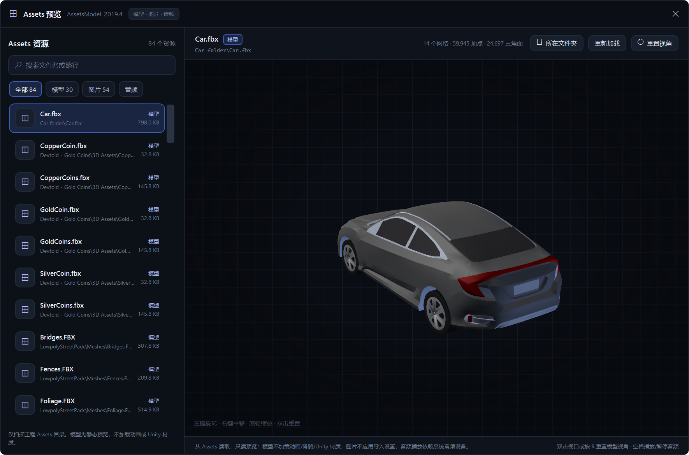

<p align="center">
  
</p>

<h1 align="center">Unity Project Gallery</h1>

<p align="center">
  <b>把散落在硬盘里的 Unity 工程，收进一个可浏览、可检索、可讲述的作品库。</b><br>
  工程封面、截图与视频、功能说明、Assets 预览与一键启动，<br>
  都在一个原生 Windows 应用里。离线、本地优先、开源。
</p>

<p align="center">
  
  
  
  
</p>

<p align="center">
  <a href="#功能特性">功能特性</a> ·
  <a href="#开箱内容">开箱内容</a> ·
  <a href="#预览边界">预览边界</a> ·
  <a href="#实现细节">实现细节</a> ·
  <a href="#快速开始">快速开始</a> ·
  <a href="#数据与隐私">数据与隐私</a> ·
  <a href="#反馈">反馈</a>
</p>

<br>

<p align="center">
  
  <br>
  <sub>项目库：所有工程按封面卡片排列，支持分类、搜索、收藏与最近打开筛选。</sub>
</p>

> [!NOTE]
> 当前版本为 **0.11.0-beta 测试版**，发布包未做代码签名。首次试用前请备份重要 Unity 工程，不要在唯一副本上测试。完整说明见 [BETA_RELEASE_NOTES.md](BETA_RELEASE_NOTES.md)。

<br>

<table>
  <tr>
    <td width="25%" valign="top">
      <h3>🗂️ 工程一览</h3>
      封面、分类、搜索、收藏与最近打开，所有 Unity 工程集中在一个窗口里，卡片按视口按需创建，工程再多也不卡。
    </td>
    <td width="25%" valign="top">
      <h3>🔍 自动识别</h3>
      递归扫描目录，识别同时包含 <code>Assets</code>、<code>Packages</code>、<code>ProjectSettings</code> 的工程，并读取 Unity 版本与依赖包。
    </td>
    <td width="25%" valign="top">
      <h3>🎬 素材就在工程里</h3>
      只读工程根目录 <code>_ProjectPreview/</code> 中的截图与视频，生成缩略图、视频封面，支持大图与全屏播放。
    </td>
    <td width="25%" valign="top">
      <h3>🧊 Assets 直接预览</h3>
      模型、图片、音频按需扫描与加载，旋转、缩放、播放都不依赖 Unity Editor，也不会改动原始资源。
    </td>
  </tr>
</table>

<br>

## 功能特性

### 工程再多，也能一眼找到

添加包含 Unity 工程的根目录后，软件会在后台递归扫描并按路径增量合并：已有工程更新版本与依赖信息，新工程自动生成卡片，封面、隐藏状态、功能关联与用户编辑都会保留。

搜索同时覆盖工程名称、路径、简介、标签与功能名称；左侧分类按标签聚合，顶部可切换全部、收藏与最近打开，排序支持最近修改、最近打开、名称 A-Z 与 Unity 版本。卡片网格使用固定尺寸虚拟化面板，只创建视口内的卡片，窗口缩放时自动重排列数。

<br>

### 每个工程都有自己的档案

<p align="center">
  
</p>

详情页集中维护工程的展示内容：简介支持多行编辑，其中的网址会自动变成可点击链接；标签用逗号分隔，保存后同步更新卡片、分类与筛选；功能模块可以新增、编辑、删除，并关联 <code>_ProjectPreview</code> 中的图片或视频；每条素材还能补一句说明。

封面可以手动指定，图片和视频封面都行；收藏与最近打开时间同步到列表。「定位工程」直接打开工程根目录下的 <code>Assets</code>；工程目录被移动或删除后，卡片会标记「路径失效」，详情页提供「重新关联」按新路径恢复。

<br>

### 截图和视频跟着工程走

<p align="center">
  
</p>

展示素材固定读取工程根目录下的 <code>_ProjectPreview/</code>，不扫描 <code>Screenshots</code>、<code>Videos</code> 等其他目录，也不会进入 <code>Library</code> 等缓存。图片会读取尺寸并生成本地缩略图；视频通过 FFmpeg 读取时长与封面，扫描失败只记录警告，不中断整个工程。

点击图片打开大图查看窗口，点击视频打开播放器，支持播放/暂停、进度拖动与全屏（F11 或全屏按钮，Esc 退出）。素材可以从展示索引中移除并随时恢复，原始文件始终保持不动。

<br>

### Assets 里的模型、图片、音频直接看

<p align="center">
  
  <br>
  <sub>Assets 预览：左侧按模型 / 图片 / 音频筛选并搜索，右侧模型支持旋转、平移与缩放。</sub>
</p>

独立窗口按需扫描工程 <code>Assets</code> 目录，按「全部 / 模型 / 图片 / 音频」筛选，并支持按文件名或相对路径搜索。

- **模型**：glTF、GLB、OBJ、FBX，使用 WPF <code>Viewport3D</code> 静态显示；左键旋转、右键平移、滚轮缩放，双击或按 <code>R</code> 重置视角。
- **图片**：按原图比例缩放显示，并提供「打开大图」入口。
- **音频**：支持播放/暂停、进度拖动与时长显示，空格键可切换播放状态。
- **定位**：选中资源后点击「所在文件夹」，直接在资源管理器中打开该文件所在目录。
- **刷新**：「重新加载」重新解析当前资源，「重新扫描」在文件变化后刷新列表。

模型仅做静态预览：不加载动画、骨骼或蒙皮，也不还原 Unity 材质，只显示基础漫反射颜色。单个模型超过 200 万顶点或三角面时停止加载并提示。

<br>

## 开箱内容

<table>
  <tr>
    <td width="33%" valign="top">
      <h4>🔎 识别与扫描</h4>
      以 <code>Assets</code>、<code>Packages</code>、<code>ProjectSettings</code> 三目录判定 Unity 工程；读取 <code>ProjectVersion.txt</code> 与 <code>manifest.json</code>，展示 Unity 版本和依赖包。
      <br><br>
      扫描在后台执行，实时显示当前目录、目录进度与已发现工程数，可随时取消；跳过 <code>Library</code>、<code>Temp</code>、<code>Logs</code>、<code>Obj</code> 与符号链接，多个扫描根目录自动去重。
    </td>
    <td width="33%" valign="top">
      <h4>🎞️ 支持的素材格式</h4>
      展示素材：PNG、JPG/JPEG、WEBP、BMP；视频 MP4、MOV、AVI、MKV、WEBM。
      <br><br>
      Assets 模型：glTF、GLB、OBJ、FBX；图片 PNG、JPG/JPEG、BMP、GIF、TIFF、WebP；音频 WAV、MP3、OGG、AIFF、FLAC、M4A。
    </td>
    <td width="33%" valign="top">
      <h4>💾 数据与恢复</h4>
      工程索引、素材、功能与用户编辑保存到本地 SQLite（WAL 模式）；同时把可移植副本写入工程目录的 <code>_ProjectPreview/project-gallery.json</code>，只含相对路径，工程搬家或换机后仍能恢复。
    </td>
  </tr>
  <tr>
    <td width="33%" valign="top">
      <h4>🚀 启动工程</h4>
      自动发现 Unity Hub 与常见安装目录中的 Editor；启动时优先使用与工程版本精确匹配的路径，其次使用设置页的默认版本，仍找不到才让你选择其他 Editor 或通过 Unity Hub 打开。
      <br><br>
      启动成功后记录最近打开时间，并同步「最近打开」筛选、排序与导航计数。
    </td>
    <td width="33%" valign="top">
      <h4>🧰 Unity Editor 管理</h4>
      设置页以表格展示已识别的版本、路径与状态。可手动添加 <code>Unity.exe</code> 并自动读取版本，同一版本允许多个安装路径；失效路径标记为「文件缺失」，支持逐条删除或批量清理。
      <br><br>
      手动记录与默认版本保存在 <code>unity-editors.json</code>，自动发现的记录不写入配置。
    </td>
    <td width="33%" valign="top">
      <h4>⚡ 性能与稳定</h4>
      扫描、缩略图、模型解析、图片解码与数据库读写都在后台线程执行；切换资源会取消上一次加载。缺失或损坏的图片、视频回退到占位样式，界面不中断。
      <br><br>
      全局异常写入本地日志；关闭窗口前会等待已排队的保存任务完成，避免快速退出丢失编辑。
    </td>
  </tr>
</table>

<br>

## 预览边界

素材与预览能力尽量覆盖常用格式，但边界同样明确：

- **模型是静态预览**：不加载动画、骨骼、蒙皮，也不还原 Unity 材质、贴图与 Shader；只使用 Assimp 输出的三角网格与基础漫反射颜色，显示效果与 Unity 编辑器可能不同。单模型超过 200 万顶点或三角面会停止加载。
- **图片不应用 Unity 导入设置**：不做压缩格式、Sprite 切分或滤镜处理；WebP 等格式依赖系统 WIC 图像编解码器，GIF/TIFF 多帧只显示首帧，超大图片会占用较多内存。
- **音频依赖系统设备**：解码与播放由 NAudio 完成，OGG 使用 NAudio.Vorbis，实际效果取决于系统音频设备与编解码器。
- **视频依赖系统解码器与 FFmpeg**：播放基于 WPF <code>MediaElement</code>，时长与封面提取需要 <code>ffmpeg.exe</code> / <code>ffprobe.exe</code>；发布包不包含 FFmpeg，缺失时视频可能没有封面和时长。
- **只读原则**：原始工程与素材不会被修改；唯一写入工程目录的文件是用户编辑产生的 <code>_ProjectPreview/project-gallery.json</code>。
- **自动发现范围有限**：Unity Editor 自动发现只覆盖常见安装目录，非标准路径请在设置页手动添加；用默认版本打开更高版本工程时，Unity 可能提示升级工程。
- **测试版限制**：无安装程序、无代码签名、无自动更新、无遥测；仅提供 <code>win-x64</code> 发布包。

<br>

## 实现细节

- **分层清晰**：解决方案拆为 App / Core / Infrastructure / Models / Tests 五层，界面遵循 MVVM；扫描、仓储、Editor 设置、预览等能力通过接口隔离，便于替换与测试。
- **完整快照 + 索引列**：SQLite 的 <code>Projects</code> 表保存完整工程 JSON 快照，同时为路径、版本、收藏、最近打开保留索引列；<code>ScanRoots</code> 表保存扫描源。
- **双写与时间戳合并**：用户编辑异步写回数据库，并同步写入工程目录 JSON；启动时按 <code>SavedAt</code> 选择较新的数据，任一方写入失败都不会丢失编辑。
- **安全写入**：工程目录 JSON 使用 UTF-8、缩进格式与相对路径，先写临时文件再原子替换，避免留下半截文件；扫描过程不会写入该文件。
- **按需渲染**：卡片网格使用自定义 <code>VirtualizingWrapPanel</code>，只创建视口内的卡片并回收复用，封面按需加载。
- **后台加载**：扫描、素材索引、缩略图、模型解析、图片解码与数据库操作都在后台线程执行，结果回到 UI 线程合并。
- **测试覆盖**：72 个 xUnit 测试覆盖工程扫描、素材扫描、用户编辑、持久化、工程目录 JSON、工程启动、Editor 设置、Assets 扫描与模型加载。

<br>

## 快速开始

前置条件：

- Windows 10 / Windows 11（64 位）
- Visual Studio 2022（安装 .NET 桌面开发工作负载），或 .NET 10 SDK（含 Windows Desktop Runtime）
- FFmpeg / FFprobe（建议加入 <code>PATH</code>，用于视频时长与封面）

```powershell
git clone https://github.com/liuliyang2310/unity-project-gallery
cd unity-project-gallery
dotnet restore
dotnet build UnityProjectGallery.sln
dotnet run --project src/UnityProjectGallery.App
```

首次使用：添加包含 Unity 工程的目录并扫描 → 在设置页添加 Unity Editor 并设置默认版本（可选）→ 在详情页设定封面、查看截图与视频、打开 Assets 预览 → 编辑简介、标签、功能与素材说明 → 点击「打开工程」通过 Unity Editor 或 Unity Hub 启动。

FFmpeg 查找顺序：构造函数显式传入（测试使用）→ 环境变量 <code>FFMPEG_PATH</code>（指向目录或 <code>ffmpeg.exe</code>）→ 应用目录 → 系统 <code>PATH</code>。

<br>

## 数据与隐私

所有数据都保存在本机，不需要账号，不连接云端，不上传工程内容与素材。

| 内容 | 位置 |
|---|---|
| 工程数据库 | `%LOCALAPPDATA%\UnityProjectGallery\unity-project-gallery.db` |
| Editor 设置 | `%LOCALAPPDATA%\UnityProjectGallery\unity-editors.json` |
| 缩略图缓存 | `%LOCALAPPDATA%\UnityProjectGallery\Cache\Thumbnails` |
| 运行日志 | `%LOCALAPPDATA%\UnityProjectGallery\Logs` |
| 工程用户编辑 | `<工程目录>\_ProjectPreview\project-gallery.json` |

软件只读取工程文件、写入自身缓存与数据库；唯一的例外是按用户编辑同步写入 <code>project-gallery.json</code>，不会修改工程内的其他文件。

<br>

## 反馈

问题反馈与功能建议请通过 [GitHub Issues](https://github.com/liuliyang2310/unity-project-gallery/issues) 提交，并附上：

- 软件版本（例如 `0.11.0-beta`）
- Windows 版本
- 操作步骤与预期结果
- 实际结果与截图
- `%LOCALAPPDATA%\UnityProjectGallery\Logs` 下对应日期的日志

<br>

## 持续集成

推送到 <code>master</code> 或提交 Pull Request 时，GitHub Actions 会在 Windows 环境执行还原、Release 构建与全部单元测试，工作流见 [.github/workflows/build.yml](.github/workflows/build.yml)。

<br>

---

## 开源协议与致谢

本项目使用 [MIT License](LICENSE) 开源，Copyright (c) 2026 LeonLiu。你可以在保留版权与许可声明的前提下自由使用、修改和分发本项目。

第三方组件与许可证说明见 [THIRD_PARTY_NOTICES.md](THIRD_PARTY_NOTICES.md)。

<sub>Unity 是 Unity Technologies 的商标。本项目是独立的开源工具，与 Unity Technologies 无隶属关系；相关名称仅用于描述其兼容的工程格式。</sub>
