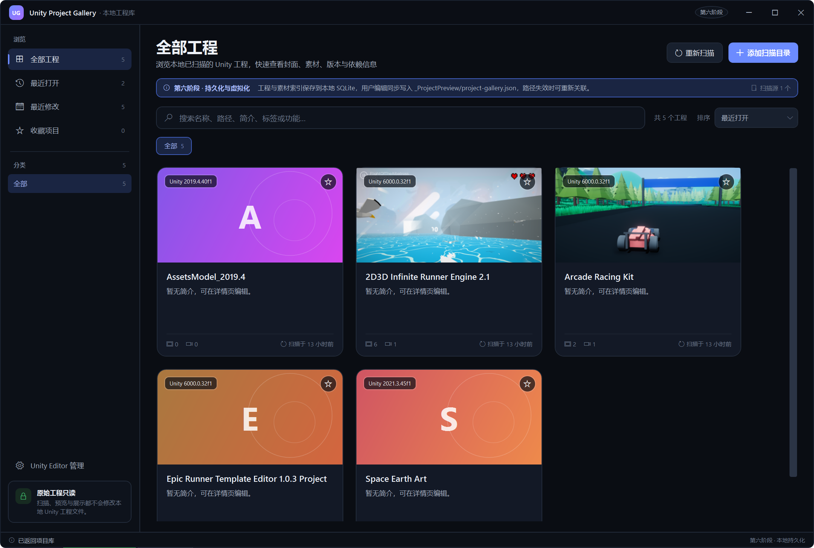
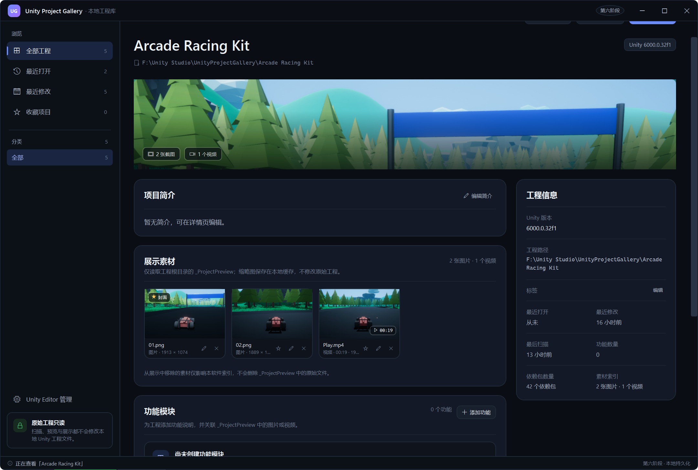
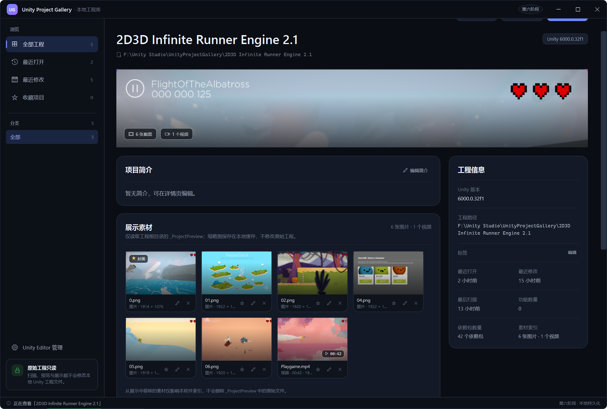

# Unity Project Gallery

用于集中管理本地多个 Unity 工程的 Windows 桌面软件。通过工程封面、截图、视频和功能说明，让每个 Unity 工程的用途与实现效果一目了然。

**当前版本：0.9.0-beta（测试版）。六个阶段功能已完成，并包含「Unity Editor 管理」设置页、工程目录 JSON 元数据同步、路径重关联与全局异常日志。开源协议：MIT。**

## 界面预览

### 项目库

<p align="center">
  
</p>

### 工程详情

<p align="center">
  
</p>

### 多素材与视频

<p align="center">
  
</p>

## 技术栈

- Windows 10 / Windows 11
- .NET 10 + WPF
- C# / MVVM
- SQLite（Microsoft.Data.Sqlite）
- System.Text.Json（SQLite 快照与工程目录元数据）
- FFmpeg / FFprobe（视频时长与封面、WebP 兜底解码）

## 已完成功能

### 第一阶段：框架与界面

- App / Core / Infrastructure / Models / Tests 五层解决方案结构。
- 深色主题规范、自定义标题栏、可缩放窗口、左侧导航、分类、搜索、排序与自适应卡片网格。
- 工程详情页基础布局，收藏状态在列表与详情页同步。

### 第二阶段：Unity 工程扫描

- 通过目录选择框添加多个扫描根目录，递归识别同时包含 `Assets`、`Packages`、`ProjectSettings` 的 Unity 工程。
- 读取 `ProjectVersion.txt` 的 Unity 版本，解析 `manifest.json` 的依赖包名称与版本。
- 扫描可在后台执行，并显示当前目录、目录进度与已发现工程数，支持取消。
- 扫描根目录与工程路径自动去重，跳过 `Library`、`Temp`、`Logs`、`Obj` 等缓存目录与符号链接。
- 扫描结果增量合并：已有路径更新信息，新路径新增卡片；保留用户维护的数据。
- 扫描根目录写入 SQLite，应用重启后自动恢复。

### 第三阶段：截图与视频管理

- 仅扫描每个工程根目录下的 `_ProjectPreview/`，不访问工程内其他素材目录。
- 支持图片：PNG、JPG/JPEG、WEBP、BMP；支持视频：MP4、MOV、AVI、MKV、WEBM。
- 自动读取图片尺寸，并在本地缓存生成缩略图。
- 自动读取视频时长，使用 FFmpeg 提取视频封面；无法读取时给出提示而不中断扫描。
- 详情页新增素材网格，展示缩略图、图片尺寸、视频时长和封面标记。
- 点击图片打开大图查看窗口；点击视频打开播放器，支持播放/暂停、进度拖动和全屏（F11 / 全屏按钮，Esc 退出）。
- 支持手动指定项目封面，图片与视频封面均可设为封面；默认优先使用 `_ProjectPreview` 第一层图片。
- 支持从展示索引中移除素材与恢复显示，原始文件保持不动。
- 自动封面、手动封面与素材显示状态在重新扫描后保留，并写入 SQLite。

> 素材缩略图缓存在 `%LOCALAPPDATA%\UnityProjectGallery\Cache\Thumbnails`，不会复制或修改原始素材。

### 第四阶段：项目详情和功能说明

- 项目简介支持在详情页直接编辑并即时更新卡片与搜索结果；支持换行的多行简介。
- 简介中的 `http/https` 网址（以及 `www.` 开头的地址）会自动显示为可点击链接，点击后使用系统默认浏览器打开。
- 标签支持编辑，使用逗号分隔；保存后同步更新工程卡片、详情页标签、左侧分类与筛选。
- 新增功能模块管理：可以添加、编辑和删除功能，填写功能名称与说明。
- 功能编辑器可以勾选 `_ProjectPreview` 中的图片或视频进行关联；一个素材只保留一个功能关联。
- 功能卡片展示关联素材数量与文件名，素材缩略图显示所属功能标记。
- 每条素材支持编辑说明文字，说明会显示在素材卡片中。
- 删除功能只会解除素材关联，不会删除任何工程或素材文件。
- 简介、标签、功能、素材说明与素材关联均异步写入 SQLite，重启后完整恢复。

### 第五阶段：搜索和工程启动

- 搜索范围新增功能名称，可同时检索工程名称、路径、简介、标签与功能名称。
- 自动发现本机 Unity Editor：扫描 Unity Hub 默认安装目录、Hub 自定义安装根目录与旧版独立安装位置。
- 启动工程前检查工程路径是否存在，并使用 `-projectPath` 参数通过 Unity Editor 打开。
- 优先匹配工程 `ProjectVersion.txt` 中的精确 Unity 版本。
- 找不到对应版本时，弹出提示窗口，可选择本机其他 `Unity.exe` 或通过 Unity Hub 打开。
- 用户选择的编辑器路径会按 Unity 版本记入当前会话，后续同版本工程可直接复用。
- Unity Hub 通过常见安装位置自动定位，并尝试以 `--projectPath` 参数打开工程。
- 启动成功后记录工程的最近打开时间，同步更新「最近打开」筛选、排序与导航计数。
- 最近打开时间写入 SQLite；临时选择的 Editor 路径只在当前会话内复用，长期路径请在设置页手动添加。

### 第六阶段：持久化、路径恢复与虚拟化

- 使用 SQLite 保存工程信息、工程路径、Unity 版本、截图/视频索引、标签、功能说明、收藏状态与最近打开时间。
- 数据库位置：`%LOCALAPPDATA%\UnityProjectGallery\unity-project-gallery.db`，启用 WAL 日志模式。
- `Projects` 表保存完整工程 JSON 快照，同时为路径、版本、收藏与最近打开等基础信息保留索引列；`ScanRoots` 表保存扫描源。
- 启动时从数据库恢复工程列表、素材索引、功能与封面，不自动触发扫描；单条快照 JSON 损坏时跳过该条，其余工程正常加载。
- 所有用户编辑（简介、标签、功能、素材说明、封面、展示状态、收藏、最近打开、路径重关联）都会异步写回数据库，不阻塞界面。
- 用户编辑还会同步写入工程目录内的 `_ProjectPreview/project-gallery.json`，文件使用 UTF-8、缩进格式和相对路径，便于随工程一起移动、备份或迁移。
- 元数据 JSON 只写用户维护的内容与素材相对路径，不包含缩略图缓存或本机绝对路径；工程目录不存在时跳过写入。
- 工程原本没有 `_ProjectPreview` 时，首次用户编辑会自动创建该目录，仅用于保存元数据文件；扫描过程不会创建目录。
- 写入采用临时文件替换，避免中途失败留下不完整 JSON；工程扫描不会写入该文件，`.json` 也不计入图片/视频索引。
- 启动时读取 SQLite 与工程目录 JSON，并按 `SavedAt` 与数据库中的用户编辑时间选择较新的数据，避免任一方写入失败时丢失编辑。
- 新扫描到的工程即使数据库中没有记录，也会优先读取其 `_ProjectPreview/project-gallery.json` 恢复用户内容。
- 关闭窗口前会等待已排队的保存任务完成（最多 5 秒），避免快速退出丢失数据。
- 工程目录移动或删除后，卡片显示「路径失效」标记，详情页显示警告条，并提供「重新关联」按钮。
- 重新关联会选择新的工程目录，校验其包含 `Assets`、`Packages` 与 `ProjectSettings`，随后更新工程路径、素材绝对路径与数据库记录。
- 增量扫描继续合并同路径工程，保留封面、隐藏素材、功能关联与用户编辑内容，不会重复创建卡片。
- 卡片网格改为 `ListBox` + 自定义 `VirtualizingWrapPanel`：固定 330 × 336 卡片、352 × 358 槽位，只创建视口内的卡片并回收复用；窗口缩放时自动重算列数，封面按需加载。
- 缺失或损坏的图片、视频不会中断界面：封面与缩略图回退到占位样式，查看器会显示明确的错误提示。
- 详情页「定位工程」会在资源管理器中打开该工程根目录下的 `Assets` 文件夹；目录或 `Assets` 缺失时在状态栏提示。

### 扩展功能：Unity Editor 管理

- 左侧导航新增「Unity Editor 管理」设置页，以表格展示 Unity 版本、Editor 路径与状态。
- 支持手动添加 `Unity.exe`，自动读取其 Unity 版本；同一版本可添加多个安装路径。
- 自动合并 Unity Hub 与常见安装目录中发现的本机 Editor，手动记录标记为「手动添加」，自动记录标记为「自动发现」。
- 状态实时检查 `Unity.exe` 是否存在，失效路径显示为「文件缺失」，可逐条删除或使用「清理失效」批量清理手动记录。
- 可设置默认启动版本：启动工程时优先使用与工程版本精确匹配的 Editor；找不到时再尝试默认版本，最后才弹出选择窗口。
- 手动 Editor 记录与默认版本保存到 `%LOCALAPPDATA%\UnityProjectGallery\unity-editors.json`；自动发现的记录不写入配置，重新打开页面时会重新检测。

## 媒体扫描规则

素材目录固定为：

```text
<Unity 工程根目录>/_ProjectPreview/
```

- 会递归读取该目录内的受支持图片与视频，但不会扫描 `Screenshots`、`Videos` 或其他工程目录。
- 识别工程根目录后停止向工程内部遍历，因此不会进入 `Library` 等缓存。
- 图片缩略图与视频封面写入软件缓存；移除展示索引只影响软件数据，不删除原文件。
- 无法解码的图片、损坏的视频或缺失的 FFmpeg 会记录在素材警告中，工程与其余素材仍正常显示。
- `_ProjectPreview/project-gallery.json` 是软件同步的用户元数据文件，不属于展示素材，不参与图片/视频索引。

## FFmpeg 配置

视频时长与封面依赖 `ffmpeg.exe` / `ffprobe.exe`。优先级：

1. 构造函数显式传入路径（测试使用）。
2. 环境变量 `FFMPEG_PATH`（可指向包含可执行文件的目录或 `ffmpeg.exe`）。
3. 应用目录中的可执行文件。
4. 系统 `PATH`。

将 FFmpeg 的 `bin` 目录加入 `PATH` 即可。缺少 FFmpeg 时图片扫描仍可用，但视频时长与封面不可用。

## 目录结构

```text
UnityProjectGallery/
├── UnityProjectGallery.sln
├── README.md
├── src/
│   ├── UnityProjectGallery.App/              # 窗口、视图、ViewModel、主题、设置页、虚拟化面板与媒体查看器
│   ├── UnityProjectGallery.Core/             # 仓储/扫描/Editor 设置接口、扫描进度契约
│   ├── UnityProjectGallery.Infrastructure/   # Unity 工程/Editor 扫描、Editor 设置存储、素材扫描、FFmpeg、缩略图缓存、SQLite 仓储
│   └── UnityProjectGallery.Models/           # 工程、Editor 设置、依赖包、功能与媒体素材模型
└── tests/
    └── UnityProjectGallery.Tests/            # xUnit 测试
```

## 构建与运行

前置条件：

- Windows 10 / Windows 11
- Visual Studio 2022（安装 .NET 桌面开发工作负载），或 .NET 10 SDK（含 Windows Desktop Runtime）
- FFmpeg / FFprobe（建议加入 PATH）

```powershell
dotnet restore
dotnet build UnityProjectGallery.sln
dotnet run --project src/UnityProjectGallery.App
```

使用流程：添加包含 Unity 工程的目录 → 扫描工程与 `_ProjectPreview` 素材 → 在设置页添加 Unity Editor 并设置默认版本（可选）→ 在详情页查看、设定封面、播放视频 → 编辑简介与标签 → 创建功能并关联素材、补充素材说明 → 点击「打开工程」通过 Unity Editor 或 Unity Hub 启动 → 下次启动时工程与编辑内容自动从 SQLite 恢复；工程移动后使用「重新关联」恢复路径。

## 测试

```powershell
dotnet test tests/UnityProjectGallery.Tests/UnityProjectGallery.Tests.csproj
```

当前共 51 个测试：

- 工程扫描器（7 个）：工程识别、版本与依赖解析、重复路径去重、缓存目录跳过、无效目录容错、进度报告、取消扫描。
- 素材扫描器（5 个）：素材目录限定、嵌套图片与缩略图、损坏图片容错、WebP 识别、视频时长与封面（FFmpeg 可用时）。
- 项目编辑（4 个）：简介与标签编辑、功能创建与素材关联、素材说明编辑、删除功能清理关联。
- 简介链接（3 个）：多网址识别、`www.` 补全 HTTPS、中文标点边界处理。
- 工程启动（6 个）：精确版本启动、手动管理路径优先且跳过失效路径、默认版本回退、缺失时选择编辑器并复用路径、通过 Unity Hub 打开、工程路径失效保护。
- Unity Editor 定位（1 个）：按 Hub 版本目录发现 Unity.exe。
- Unity Editor 设置（6 个）：设置文件往返多个路径与默认版本、缺失/损坏文件容错、版本自动读取回退、自动与手动记录合并、添加/去重、删除失效记录并清理默认版本。
- 搜索（2 个）：功能名称命中与不误匹配。
- SQLite 持久化（3 个）：完整快照跨实例读取、按工程 ID 更新路径、扫描源往返。
- 工程持久化恢复（3 个）：快照恢复功能/素材/封面/隐藏状态、重新关联更新工程与素材路径、拒绝非 Unity 目录。
- 工程目录 JSON（5 个）：创建 `_ProjectPreview` 并往返元数据、缺失/损坏文件容错、较新 JSON 覆盖快照、较旧 JSON 不覆盖快照、区分用户编辑与扫描更新。
- 工程定位（2 个）：定位命令打开工程的 Assets 文件夹、Assets 缺失时给出提示。
- MVVM 基础（4 个）：命令执行、可用性判断、变更通知与泛型参数传递。

## 设计约定

- 原始 Unity 工程与素材只读，软件只读取文件、写入自身缓存与数据库；唯一的例外是按用户明确要求，将用户编辑写入 `_ProjectPreview/project-gallery.json`，不会修改其他工程文件。
- 仅从 `_ProjectPreview/` 读取展示素材，不扫描工程其他目录。
- 扫描、素材索引、缩略图生成与数据库读写均在后台线程执行，最后回到 UI 线程合并结果。
- 核心能力通过接口隔离：`IUnityProjectScanner`、`IProjectMediaScanner`、`IProjectRepository`、`IProjectMetadataStore`、`IScanFolderPicker`、`IProjectPathPicker`、`IProjectFolderRevealService`、`IMediaViewerService`、`IUnityEditorLocator`、`IUnityEditorSettingsStore`、`IUnityEditorVersionReader`、`IProjectLaunchService`。
- ViewModel 负责状态与交互，`MainWindow.xaml.cs` 仅处理窗口控制与退出前的保存冲刷。
- SQLite 采用「完整 JSON 快照 + 基础索引列」：工程结构会随功能增加而变化，快照可整体还原素材、功能与用户状态；索引列便于排查与后续扩展。
- 工程目录内的 `project-gallery.json` 是用户编辑数据的可移植副本，只保存相对路径；启动时与 SQLite 快照按时间戳合并，工程移动或数据库重建后仍可恢复。
- 卡片网格使用固定尺寸虚拟化面板，只生成视口内的容器；筛选、搜索与窗口缩放都会重新计算可见范围。
- 视频播放基于 WPF `MediaElement`，实际可播放格式取决于系统已安装的解码器；不支持时会显示错误提示。
- 工程启动优先使用设置页中匹配版本的有效路径，其次使用本次会话临时选择的路径；都没有时尝试默认启动版本，仍找不到才由用户选择其他 Editor 或通过 Unity Hub 打开。

## Beta 发布与反馈

- 当前测试版说明、FFmpeg 配置、数据位置、已知限制与干净环境验收清单见 [BETA_RELEASE_NOTES.md](BETA_RELEASE_NOTES.md)。
- 第三方组件与许可证说明见 [THIRD_PARTY_NOTICES.md](THIRD_PARTY_NOTICES.md)。
- 问题反馈与功能建议请通过 GitHub Issues 提交，并附上版本号、Windows 版本、复现步骤与日志文件。
- 日志目录：`%LOCALAPPDATA%\UnityProjectGallery\Logs`。

## 开源协议

本项目使用 [MIT License](LICENSE) 开源。你可以在保留版权与许可声明的前提下自由使用、修改和分发本项目。

## 持续集成

推送到 `master` 或提交 Pull Request 时，GitHub Actions 会在 Windows 环境执行还原、Release 构建与全部单元测试。工作流见 [.github/workflows/build.yml](.github/workflows/build.yml)。
